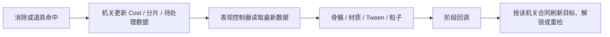

# 特殊玩法表现：蛇、果冻、无人机与糖果机的实现还原

分析日期：2026-11-25。对象：Hexa Sort 6.2.20，ARM64 样本 SHA256 `56c3f96084cfd0d7b61b75fa555c83ed5ca07d9696f4ad0bf5fcf18e04fd1d02`。

这轮把前一版的“有什么模型”推进到“哪些数据驱动哪些对象、怎样变化、何时回调”。证据来自原始 Unity 序列化文件、v39 metadata、IL2CPP 指令及导出动画。**未运行原版画面对拍，也未把这些表现接入复刻项目。**“确认”指静态证据闭合；涉及最终观感和 Shader 像素结果仍另列未决。

- [178 段方法指令](SpecialVisualImplementation.asm)、[字段/方法/常量/字符串记录](SPECIAL_CELL_VISUAL_IMPLEMENTATION.json)。方法范围按下一不同的 Assembly-CSharp 方法指针截取，保留共享地址别名，不等价于恢复完整源码。
- [49 个原始组件及补充 Mesh/Material 数据](SPECIAL_CELL_VISUAL_ASSET_VALUES.json)。每个组件均完整消费序列化 payload，记录原始 bytes、SHA256、字段偏移和 PPtr；没有拿运行时内存偏移直接读取资源。
- 生成入口：[inspect_hexa_visual_implementation.py](../../scripts/inspect_hexa_visual_implementation.py)。纯静态读取，不连接设备，不修改关卡、存档或 Unity 资产。

## 1. 表现对象与逻辑格的对应关系

| 机关 | 逻辑数据 | 已确认的表现组织 | 实现时的关键点 |
|---|---|---|---|
| 蛇 25/26 | 多格同 ID、各段 Cost、尾格最大长度 | 尾格持有整条 SkinnedMesh、39 个采样组件和控制点容器 | 收缩改变整条蛇的采样跨度；蛇身逻辑格不各自渲染一段网格 |
| 果冻 35 | Rotation、Segments、JelliesStatus[] | 外层 JellyHex 动态创建二片或三片 JellyBlock | 方向索引必须对应原始序列化数组，不能按物体名称排序 |
| 无人机 30/31/32 | 站点 ID、Cost、当前承接状态 | 接收器管理飞行对象，飞行根、机身、携带块、掉落复制块分开 | 起飞、掉块、目标接管、最终收集有不同回调时点 |
| 糖果 53/54 | 同 ID 糖果格的剩余 Cost 总和 | 一个机器内的长网格随总量移动/修改材质，另实例化飞向 HUD 的糖果 | 本轮确认主网格受总量控制；原始 Shader 裁切公式仍缺失 |



这只是职责图，不能把所有机关的计分统一挪到动画结束。蛇目标在收卷前已经入账，糖果也先计分；果冻收集粒子到达后的调用是目标视图更新。具体逻辑入口见各玩法文档。

## 2. 蛇：路径、骨骼、收卷和卷筒

### 2.1 控制点来自逻辑路径，骨骼独立采样

`GeneratePieces`（`0x2181558`）从当前格邻居中找第一个满足 `SnakeBody && 同 ID && 邻居Cost == 当前Cost - 2` 的格，沿该规则递归；控制点放在目标格世界位置加 `(0, 0.2, 0)`。首段使用已有 `_secondTangentPoint`，后续复制 `_snakeTangentObject` 到 `_snakePiecesContainer`。只有尾格时另外生成虚拟控制点。不存在按每个身体 prefab 播一段弯曲动画的循环。

`SnakeSpline.GetTransforms`（`0x1f65114`）按容器的直接子节点顺序读取控制点；`SetupSplineInterpolator`（`0x1f65274`）将时间分配为 `i / (N - 1)`。`SetInput`（`0x1f656dc`）在列表两端重复端点，给三次插值提供边界点。

`GetHermiteInternal`（`0x1f65a50`）的公式已经闭合。令 `p0,p1,p2,p3` 是连续四个节点，局部参数为 `u`：

```text
m1 = (p2 - p0) / 2
m2 = (p3 - p1) / 2
H(u) = (2u³ - 3u² + 1) p1
     + (u³ - 2u² + u) m1
     + (-2u³ + 3u²) p2
     + (u³ - u²) m2
```

这是采用居中差分切线的三次 Hermite，即常用的 Catmull–Rom 形式。`GetHermiteAtTime`（`0x1f65388`）先按节点 Time 找区间，再换算局部 `u`；超过最后有效时间返回倒数第二个节点位置，节点不足四个返回零向量。

原始 SnakeTailHex 资产 `d21ac…:158` 引用 `SnakeParameters:151`、`SnakeSpline:150`。39 个 `UpdatePosFromSnakeSpline` 组件的 `number` 恰好为 **1…39**，`MaxNumber=39`，`lookAheadDist≈0.18`，全部引用参数组件 151。它们包括头部和 38 个 Tail 节点，不能把层级中的 38 个 Tail 当作全部采样组件数。

每个骨骼的 `Update`（`0x1f6787c`）读取：

```text
S = spline.SplineLength
L = parameters.SnakeLength
t = parameters.DistanceOnSpline / S + (number / MaxNumber) * (L / S)
ahead = lookAheadDist / S
if t < 0: t += 1
tAhead = t + ahead
if tAhead > 1:
    tAhead = loop ? tAhead - 1 : 1
    if t >= 1: t = loop ? t - 1 : 0.999999
position = GetHermiteAtTime(t)
LookAt(GetHermiteAtTime(tAhead))
Rotate(localForward, GetZRotationAtTime(t), Space.Self)
```

这里的越界是一次加/减，不是任意次数的 modulo；最后还沿自身前轴补转控制点的 Z 角。`GetZRotationAtTime`（`0x1f65bf4`）在两端 Z 欧拉角之间使用最短角差，局部比例 Clamp01 后插值，避免跨 0° 时绕长圈。

### 2.2 长度由 Cost 换算，必须使用资源覆盖值

| 字段 | 构造函数默认 | 原始 prefab 值 |
|---|---:|---:|
| `_snakeLengthFactor` | 0.95 | **0.97** |
| `_initialLengthFactor` | 2.3 | **0** |
| `CarpetRollRotationFactor` | 10 | **11.25°** |
| `LengthFactor` | 1 | **4** |
| `SnakeParameters.SnakeLength` | — | **0.55** |
| `DistanceOnSpline` / `splineFollowSpeed` | — | **0 / 0** |
| `animateOnSpline` / `loop` | — | **false / false** |

`CalculateSnakeLength`（`0x2180f98`）及 Execute 的计算为：`Cost == 0 ? 0 : 0.97 × (Cost - 2)`。最大长度 `M` 来自尾格 AdditionalParam 的整数及初始化回填路径，见[蛇逻辑](SPECIAL_CELL_MOVEMENT.md)。资源内保存的 `SplineLength≈2.0044` 是静态初值，不能当作每条关卡蛇的固定长度。

`StartSnakeCoroutine`（`0x2181840`）先停止旧样条协程，再从当时的可见长度向最新目标继续。协程 `MoveNext`（`0x2182534`）先等传入 delay，然后：

- 增长每帧加 `deltaTime × LengthFactor × 1.5`，本资源即约 **6 单位/秒**。
- 缩短每帧减 `deltaTime × LengthFactor`，即约 **4 单位/秒**。
- 每步更新 SnakeLength、纹理、卷筒旋转、BlendShape 和位置。缩短下一步达到或小于 **0.55** 时，结束段把长度留在 0.55；不是把网格压成零。Cost 已归零时随后进入王冠收集。
- 普通跨过目标长度的分支保留当前步长结果，不能直接写成每步精确 Clamp 到目标的 MoveTowards。

### 2.3 卷筒的四项联动公式

令 `r=Clamp01(L/M)`，普通非教程路径可还原为：

| 可见部分 | 调用及公式 |
|---|---|
| 蛇皮纹理平铺 | `SetSnakeTilling 0x2181a04`：第一个材质的 mainTextureScale = `(1, 0.3 + 0.7r)` |
| 卷筒旋转 | `RotateCarpetRoll 0x2181a8c`：当前 localRotation 右乘绕 X 轴的 `direction × 11.25°`；增长 direction=+1，缩短=-1 |
| 卷筒粗细 | `AdjustCarpetRollSize 0x2181b94`：`SetBlendShapeWeight(0, 60 - 45r)` |
| 卷筒位置 | `AdjustCarpetRollPos 0x2181bec`：保留 local X，Y=`0.48 - 0.2r`，Z=`0.2 + 0.4r`；输入 L<=0.01 时按零比例 |

卷筒 Mesh `0f0f…:1` 的 BlendShape 0 名为 **`blendShape2.BigRoll`**，因此“变粗”有网格形变证据。`r=1` 时形变权重 15、位置约 `(x,0.28,0.6)`；`r=0` 时为 60、`(x,0.48,0.2)`。实际终止长度是 0.55，所以最终比例不一定为零。

旋转方法本身没有乘 deltaTime，而长度变化有乘。这意味着按原指令复现时，旋转累计量受帧数影响；改成按距离转动属于工程调整，不能写成原版公式。教程还会改写最大长度和 Animator，不能把上表直接推广到教程。

### 2.4 重参数化：有实现，不代表正常玩法调用了它

`UpdateSpline`（`0x1f64edc`）用 `20 × 控制点数` 次采样累计折线长度。原始资源 `UpdateSplineInRuntime=true`，因此 `Update` 会重建节点和近似长度。

另一个 `CreateReparametrizedSpline`（`0x1f65f94`）会在各参数区间以 50 个步进采样，累计距离超过 ReparametrizeDistance 时创建新控制点并把累计量归零，最后切换根对象、再次 UpdateSpline。这是离散距离近似，丢弃超出阈值的余量，不是精确弧长逆映射。资源阈值为 **20**。

**未确认正常蛇路径会调用这个重采样方法**：本轮导出的直接调用中没有它的外部调用点，已检查的正常 Update/Init 也没有调用它。不能因为方法存在就给正常玩法加一次等弧长重采样；反射或其他间接入口尚未穷尽。

## 3. 果冻：方向分片、换材质、延迟消失和弹性

### 3.1 模型选择和数组顺序已确认

`JellyHex.SpawnJelly`（`0x214dccc`）按 Segments 选 prefab：

| Segments | 几片 | 字段及原始组件 | 分片/渲染器数组顺序 | 粒子数组顺序 |
|---:|---:|---|---|---|
| 3 | 2 | DoubleSplitJelly，`5c4d…:25` | **Jelly_2、Jelly_1** | FX 2、FX 1 |
| 2 | 3 | TripleSplitJelly，`36b4…:32` | Jelly_1、Jelly_2、Jelly_3 | FX 1、FX 2、FX 3 |

外层 JellyHex 原始 PPtr 直接引用这两个 JellyBlock 组件。`JellyBlock.Init`（`0x214b74c`）设置世界旋转 `Y=60°×Rotation`，按保存的 JelliesStatus[] 启停对应 GameObject，再逐个取 renderer.materials 的**索引 1**，写 `_Rotation=60×Rotation` 并回写材质数组。模型旋转与材质旋转都必须恢复。

### 3.2 一次命中的表现过程

逻辑层先按方向找到分片、清对应 bool、扣 Cost 并提交收集，见[方向公式](SPECIAL_CELL_REACTIONS.md#61-jelly35-按方向消除不能只存一个总-cost)。表现层随后执行：

1. `HideJelly`（`0x214b990`）启动摇晃和分片收集协程。
2. 协程首段把被击中 renderer 的**材质槽 0**换成 `active`，原始引用解析为 **Jellly_HiLight**。随后等待 **0.5 秒**。
3. 恢复后 SetActive(false) 隐藏该分片，播放同索引的 ParticleSystem。
4. 参数允许 HUD 收集时，从粒子位置加 Vector3.up 创建 Jelly 目标粒子，目标枚举为 **34**，传入 OnParticleCollect 回调。
5. OnParticleCollect 更新目标视图；遍历所有分片的 activeSelf，全部关闭时才调用整套模型完成委托。

证据：`0x214bddc–0x214c07c`、`0x214bb20–0x214bc9c`。这条粒子回调不应再提交一次逻辑 ItemCollected。多个分片各有自己的协程；字段 `_collectionCoroutine` 只保存最近一次句柄，HideJelly 没有先停止旧句柄。

由此也能解释短暂的“片还看得到但已经不能再次扣除”：持久 bool 已先变 false，视觉片要等 0.5 秒才隐藏。不要用 GameObject.activeSelf 代替机关逻辑判定。

### 3.3 摇晃不是拆片 Animator

`PlayJellyWobbleAnimation`（`0x214b9e0`）启用 **BoingKit.BoingBones**，在 X/Z 分别抽一个 `[-WobbleStrength,+WobbleStrength]` 的随机值，再调用 Transform.DOPunchPosition，Y=0、vibrato=10、elasticity=1。

两个原始 prefab 均为 **WobbleStrength=4、WobbleDuration=0.15 秒**，覆盖构造函数的 **0.3、0.2 秒**。因此刚体般整体位移和骨骼弹性共同参与。BoingBones 的细部弹簧设置本轮未反解，不能只凭这两个值保证软体手感完全一致。

DoubleSplitJelly / TripleSplitJelly 的导出 AnimatorController 都仅含一条 GlowEffect 状态；对应动画长 **5.5 秒且循环**，0 秒值 0、约 1.6667 秒到 1、5.5 秒仍为 1。绑定是 `material.path_0x83B1DBA9_puRNKMJ` 的哈希占位名称。它是材质属性曲线，未见切片销毁事件；拆片由上述代码协程完成。不能因导出 Animator 存在就用播放动画代替 bool、延迟、隐藏和粒子链。

## 4. 无人机：飞行与掉块是两条时间线

### 4.1 节点和参数

原始 DroneHex `05c0…:36` 的 DroneTransform 指向子节点 `Drone`，BlocksParent 指向 `BlocksParent`，BlockPrefab 指向 `DroneStackBlock`，AnimConfig 指向 `6639…:1`。构造函数的 `_blockOffset=0.3` 未被这个 prefab 的序列化字段覆盖。

`SpawnCarryingBlocks`（`0x2130ed8`）按传入数量创建显示块，局部位置是 `(0,-0.3×i,0)`；机身另按块数抬高。这些是 GameObject 表现列表，不是把棋盘 Block 数据挂到机身。

| 原始 DroneAnimationConfig 字段 | 值 | 本轮确认用途 |
|---|---:|---|
| DroneFlightInitialDelay | 1.0 s | FlyToDronePad 先播 Animator，再延迟进入飞行 routine |
| DroneMoveYDuration | 0.8 s | 正常站间升/降阶段 |
| DroneMaxYDistance / FtueMaxYDistance | 5 / 2 | 高度；站间主 routine 直接读取普通值，掉块/飞离辅助函数有教程分支 |
| GlideTransitionTime | 0.5 s | 升、平移、降阶段之间插入等待 |
| DroneGlideDurationFactor | 0.2 | 平移时长 = 当时两根节点的三维距离 D × 0.2 |
| DroneTiltDurationFactor / TiltBackDurationFactor | 0.25 / 0.25 | 机身倾斜及回正时长相对平移时长的比例 |
| DroneMaxTiltFactor / DroneMaxTilt | 4 / 20 | 倾斜量 Clamp(D×4,0,20) |
| CellDropInitialDelay / Duration / LifeTime | 0.65 / 0.45 / 1.2 s | 独立掉块序列的等待、下落和复制块清理 |
| FinalFlyOutDuration / FinalFlyOutFtueDuration | 1 / 0.75 s | 正常最终路径读取前者；已检查的 GetFlyOutDuration/最终路径教程分支实际用常量 0.5，不能直接套 0.75 |

### 4.2 正常站间转移的时间轴

以下以**进入 FlyToPadRoutine 的时刻为 t=0**，不含入口前 1 秒等待；参数按本资源读取，不含外部 timeScale 等运行覆盖。

| 相对时间 | 动作 |
|---|---|
| 0 | 创建掉落复制块并初始隐藏；另建 `_flySequence` |
| 0…0.8 s | 飞行根局部 Y 升到 5；朝目标 XZ 方向旋转，同时启动相关反馈 |
| 0.65 s | 掉块序列开始下落：启用复制块，并 RemoveLastBlock 删除携带列表末项 |
| 0.74 s | 掉块序列回调把复制块欧拉角归零，来源 `0.65+0.45×0.2` |
| 0.965 s | 插入掉块反馈，来源 `0.65+0.45×0.7` |
| 1.1 s | 复制块下落 Tween 到尾部；本步骤本身不是格接管回调 |
| 1.2 s | `_flySequence` 的 InsertCallback 调用传入的 dropAction；独立 DelayedCall 同时负责终止掉块序列、销毁复制块 |
| 1.3 s | 0.8 秒上升 + 0.5 秒间隔后，调用排序重检事件，再开始平移 |
| 随后 0.2D 秒 | 根节点移动到目标上方；机身子节点倾斜再回正 |
| 其后 | 再等 0.5 秒，转回默认朝向、下移并调整机身高度；尾部执行传入 onComplete，再停止风扇 |

证据：入口 `0x21308cc`，主序列 `0x21310e0`，掉块 `0x21319a4`，复制块回调 `0x2132880/0x21328b0/0x2132920`，阶段回调 `0x21325fc–0x213266c`。dropAction 的业务内容由调用方决定，不把这个通用委托无条件命名为“记分”或“目标接管”。

起飞前同一无人机对象会改父节点。目标位置先由世界坐标经 parent.InverseTransformPoint 换成局部坐标，再用于 DOLocalMove。原指令也存在直接读取 position.Y 后传给 DOLocalMoveY 的混用；复刻到旋转/缩放不同的父层级时不能照抄数值后声称坐标等价。

最终离场另走 `FlyAwayRoutine`（`0x2131e54`），使用 DOPath 并缩小整体；`GetFinalFlyOutPath` 的三点数组包含 Drone 目标 HUD 位置、当前位置偏移中间点和当前位置。不能把参数里左右出场点字段的存在，直接等同于该最终收集路径实际使用了那些字段。

Animator `Drone.controller` 负责 Start/Loop、Start_Slow/Loop_Slow、End 等风扇状态；站间世界路径、倾斜与掉块均由代码 Tween 驱动。只播放 Animator 的 Start 不能完成站间移动。

## 5. 糖果机：长糖果主网格和收集用小糖果已分清

### 5.1 更新此前“格子模型未知”的范围

本轮确认机器持有的 `CandyMesh` 是 `Marshmellow_Candy` renderer，材质是 **CandyMask**，其网格局部包围盒 Y 总长约 **13.3313**，没有 BlendShape。机器还引用独立 `Marshmellow_Piece`（CandyMachineCandy + HexCollectionAnimation）作为弹出收集对象。

`CandyCellState` 构造函数中的两个间接调用现已展开为 `ICellStateContext.GetAdditionalParam`（slot22）和 `SetCellMeshState`（slot13）；这两个调用不创建单格糖果模型。结合下面的总量更新，已经有证据支持：**机器用一份长糖果网格表达绑定糖果格的整体剩余长度，飞出去的颗粒另生成。** 尚未恢复 Shader 内的可见边界计算，也未排除其他未追踪入口对格子添加装饰。

### 5.2 长度变化实际是移动加材质参数

令 `N=sum(同 ID 绑定糖果格.Cost)`，不是只数糖果格数量。`CandyMachineHex.Init`（`0x2116618`）先把机器 Animator 所在变换绕局部 Y 旋转 `direction×60°`，再设置：

```text
CandyMesh.transform.localPosition = Vector3.forward * (-0.96 * N)
CandyMesh.material.SetFloat("_TIleCount", N * 0.5)
```

**属性名确实为 `_TIleCount`，中间 I 大写**；通过 PropertyToID 的 metadata literal 和原始 CandyMask 材质双重确认。不是常见拼写 `_TileCount`。另一个属性为 `_rotation`，也应保留大小写。

`CandiesUpdated`（`0x21172bc`）每次让表现计数 N 减一，播放机器 Hit 状态，并用同一 Sequence **同时**：

- 把 CandyMesh.local Z 补间到 `-0.96×N`；
- 把材质 `_TIleCount` 补间到 `N/2`；
- 把 CandyMeshTransform（Marshmellow 父节点）的局部欧拉角推进 90°。

这几个主网格变化共用 **0.8 秒**时长常量（`0x108c8ec`），而独立糖果的 Animate 同时运行。当前函数没有逐个遍历糖果格并创建模型的循环。因此此前“尚未找到 Candy prefab”不能当作整条糖果必须逐格补模型的理由。

### 5.3 弹出物是另外一套动画

`CandyMachineHex.Init` 从 CandyPrefab 实例化一颗收集对象；`CandiesUpdated` 对它调用 `Animate`（`0x2115e98`）。后者将局部升降、跳跃、放大和随机翻转与 `HexCollectionAnimation.CreateSequence(goal=50, callback)` 组合，飞向 HUD。机器进料动画的尾部在 N 仍大于零时实例化下一颗待用物，而非按全部糖果格预先生成一排收集物。

其中 `0x2116014` 有跳到界外代码块 `0x411efa8` 的分支，本轮未把这个外置块完整展开；因此不把弹出物的所有随机/缓动细节称为已还原。已闭合的是独立对象身份、主网格总量驱动、三项联动和收集委托。

### 5.4 Shader 仍是最具体的缺口

导出 `Shader Graphs_Candymask.shader` 声明 `_TIleCount`，原始 CandyMask 启用了 AlphaClip。但导出的 Shader 主体带 **DummyShaderTextExporter**，片元只返回白色，没有原始裁切逻辑。上述 N/2 和位移可确认，**N/2 如何变成屏幕中的准确长度、端面与边缘，仍须反解编译 Shader 或原版逐档画面对照**。

果冻的 `Shader Graphs_Jelly_glow.shader` 也有同样占位问题。可提取纹理、网格和材质参数，不等于可直接还原发光/遮罩。果冻 GlowEffect 动画还带属性绑定占位名，导入后需单独核对绑定。

## 6. 可落地的实现顺序与验证边界

先复现数据到对象的映射，再逐项叠加表现：

1. 蛇：正确路径顺序 → 39 个编号采样 → 长度变化 → UV/BigRoll/位移 → 王冠回调。先检查弯角连续性和连续命中重启，不能只看直线路径。
2. 果冻：Segments 选型和原始数组 → bool 恢复 → 两个材质槽 → 0.5 秒命中阶段 → Boing/Punch → 粒子回调。重点核对二片版反序，以及视觉未隐藏时重复命中的逻辑去重。
3. 无人机：控制器/站点归属 → 根与机身坐标 → 携带显示块 → 独立掉落复制块 → 阶段委托 → HUD。重点记录 1.1 秒视觉落底与 1.2 秒业务回调的差别。
4. 糖果：N 总量和机器朝向 → 主网格位移/90°进料 → 可工作的遮罩 Shader → 独立收集糖果。Shader 精确恢复之前，只能称为近似外观。

本轮静态复核能够确认参数和调用关系，不能确认原版设备的材质实例覆盖、动画与 Update 的实际执行先后、所有 timeScale 情形或多机关并发观感。BoingBones 的完整弹簧参数、糖果外置代码块、原始 Shader 和画面对拍是明确剩余项；柜子六杯映射、其他机关逻辑及异步提交合同继续参考已有专项文档。

复核命令（Python 环境需有兼容版本的 Capstone 和 UnityPy）：

```bash
rtk proxy python3 scripts/inspect_hexa_visual_implementation.py
rtk proxy python3 scripts/inspect_hexa_visual_implementation.py --assets
```

运行时只生成本页关联的静态证据文件。2026-11-25 本轮实际生成结果为 **14 个类型字段表、178 个方法地址范围、49 个完整组件 payload、5 个 Mesh/Material 补充记录**。原始输入资源未修改。
